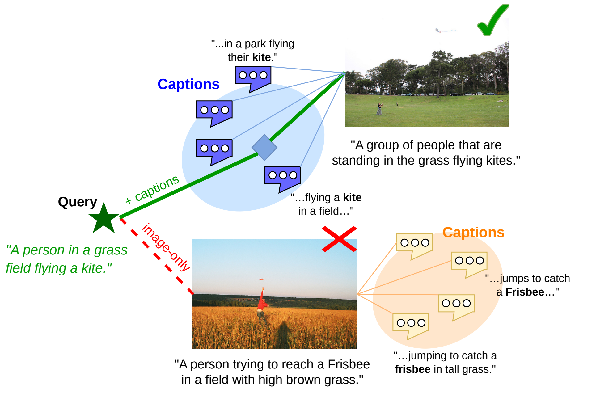
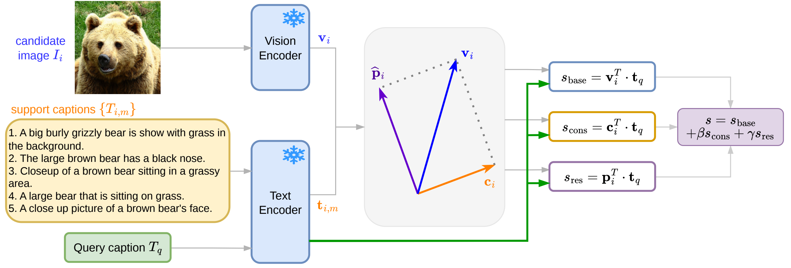
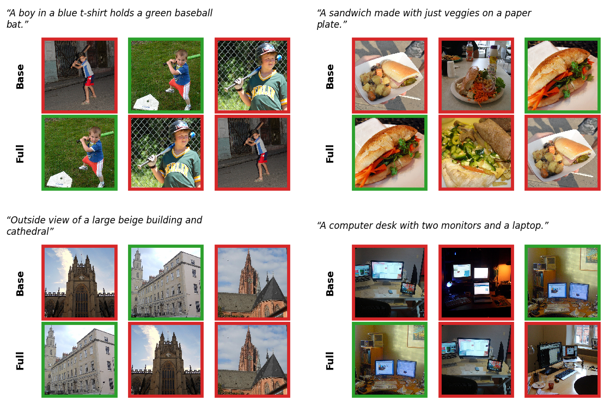
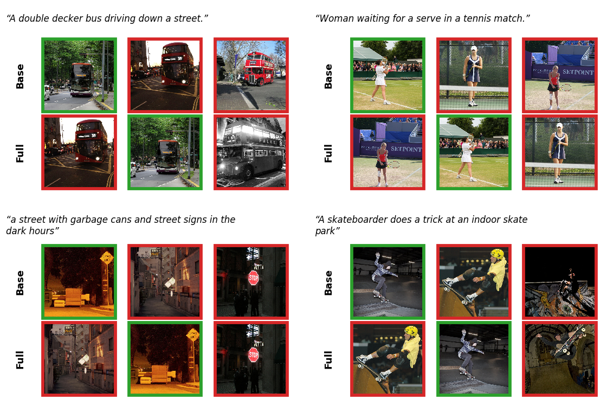

<div align="center">

# Whispers from the Neighbors: Rethinking Caption Consensus as Inference-Time Evidence for Vision-Language Retrieval

**Khang Nhat Hoang Vo** &nbsp; **Belal Shoer** &nbsp; **Abhirama Subramanyam Penamakuri**

Mohamed bin Zayed University of Artificial Intelligence (MBZUAI)

Correspondence: [Khang.Vo@mbzuai.ac.ae](mailto:Khang.Vo@mbzuai.ac.ae), [Venkata.Penamakuri@mbzuai.ac.ae](mailto:Venkata.Penamakuri@mbzuai.ac.ae)

📄 Paper (coming soon) · [Quick start](#quick-start) · [Reproducing the paper](#reproducing-the-paper)

</div>

---

## Overview

An image is rarely described only once. COCO and Flickr30K attach five human captions to every picture, and many collections store alt text or descriptions alongside each image. Yet dual encoders such as CLIP and SigLIP still score every image–caption pair in isolation. We ask **what these neighboring captions contribute when a frozen encoder consults them at inference time**, and **how to measure it without leakage**.

<p align="center">
  
</p>

<p align="center"><em>For the query "A person in a grass field flying a kite", image similarity alone prefers a photo of someone reaching for a Frisbee. The captions of the correct image, which describe people flying kites, lie much closer to the query than its image embedding does.</em></p>

We study a simple scorer: the support captions of each candidate image are averaged into a **consensus** direction, the image embedding is split into a component along this direction and a **residual**, and the query is scored against all three. This is a form of database-side augmentation and late fusion, so we do not present it as a new method. Our contributions are about **how much it helps and how to evaluate it**:

- **A leakage-free protocol.** Under a *fixed support index*, fusing image similarity with similarity to an image's own captions improves text-to-image R@1 by **3.4 to 16.8 points** across nine frozen encoders.
- **Where the gain comes from.** The gain falls to **1.9 to 7.2 points** when an off-the-shelf captioner writes the captions, and to **at most one point** when they come from a different annotation source. A paraphrase-trained text encoder over the same captions does better than the dual encoder's own text tower.
- **An account of the leave-one-out (LOO) pitfall.** The residual term appears to add 5.3 to 8.1 image-to-text R@1 points under LOO, but at most 0.7 under a fixed index. Set size and query removal each explain about half of the gap, and algebraically the residual is only a reweighting of what the captions already provide.
- **Compositional benchmarks.** On SugarCrepe and ARO, the captions help by matching candidates to human descriptions of the image, without improving image–text grounding. A blind language model solves ARO-Order.

## Method

### Consensus–residual scorer

Let $\mathbf{v}_i$ be the normalized embedding of candidate image $I_i$, $\{\mathbf{t}_{i,m}\}$ its support captions, and $\mathbf{t}_q$ the query. The caption consensus and the image residual are

$$\mathbf{c}_i = \frac{\sum_m \mathbf{t}_{i,m}}{\lVert \sum_m \mathbf{t}_{i,m} \rVert_2}, \qquad \mathbf{p}_i = \mathbf{v}_i - (\mathbf{v}_i^\top \mathbf{c}_i)\,\mathbf{c}_i, \qquad \hat{\mathbf{p}}_i = \mathbf{p}_i / \lVert \mathbf{p}_i \rVert_2 ,$$

and the final score is

$$s(I_i, T_q) = \alpha\, \underbrace{\mathbf{v}_i^\top \mathbf{t}_q}_{s_{\text{base}}} + \beta\, \underbrace{\mathbf{c}_i^\top \mathbf{t}_q}_{s_{\text{cons}}} + \gamma\, \underbrace{\hat{\mathbf{p}}_i^\top \mathbf{t}_q}_{s_{\text{res}}} .$$

We call this scorer **Full**, and the special case $\gamma = 0$ **B+C** (base plus consensus). The encoders are never updated; we fix $\alpha = 1$ and tune only $\beta$ and $\gamma$ on held-out labeled data.

<p align="center">
  
</p>
<p align="center"><em>The support captions are averaged into a consensus direction, the image embedding is split into a component along this direction and a residual, and the query is scored against the image, the consensus and the residual.</em></p>

### The residual is a reweighting

For unit vectors with $s_i = \mathbf{v}_i^\top \mathbf{c}_i$,

$$s_{\text{res}} = \frac{s_{\text{base}} - s_i\, s_{\text{cons}}}{\sqrt{1 - s_i^2}}, \qquad s = \alpha_{\text{eff}}\, s_{\text{base}} + \beta_{\text{eff}}\, s_{\text{cons}}, \qquad \alpha_{\text{eff}} = \alpha + \frac{\gamma}{\sqrt{1 - s_i^2}}, \quad \beta_{\text{eff}} = \beta - \frac{\gamma\, s_i}{\sqrt{1 - s_i^2}} .$$

So Full is base plus consensus with weights that depend on the candidate image. In image-to-text retrieval $s_i$ is fixed by the query image, so Full ranks exactly as B+C would with a query-specific consensus weight.

### Evaluation without leakage

In multi-caption benchmarks the query is usually one of the correct image's own captions, so it must be excluded from that image's supports. We compare three constructions:

| Construction | Positive's supports | Negatives' supports | Depends on the query? |
|---|:---:|:---:|:---:|
| Leave-one-out (LOO) | 4 (query removed) | 5 | yes |
| Size-matched LOO (diagnostic) | 4 (query removed) | 4 (one random caption removed) | yes |
| **Fixed support index** | **4** | **4** | **no** |

Under the fixed support index, fold $f \in \{1,\dots,5\}$ holds out caption $f$ of every image as the query, every candidate keeps its other four captions, and results are averaged over folds. This mirrors a deployed system in which unseen queries are matched against a fixed index.

## Experimental Setup

| | |
|---|---|
| **Encoders (main)** | OpenCLIP ViT-B/32, MetaCLIP ViT-B/16, DFN ViT-B/16, DataComp ViT-B/32, EVA02 ViT-B/16, SigLIP ViT-B/16 |
| **Encoders (additional)** | SigLIP2 ViT-B/16, SigLIP2 So400m/14, CLIP ViT-L/14; BLIP-2 ViT-g fine-tuned on COCO (reported separately) |
| **Tuning split** | COCO *tune2500*: images 0–2499 of the Karpathy 5K test split |
| **Evaluation** | COCO *eval2500* (images 2500–4999) and Flickr30K test1k, never used for tuning |
| **Tuning** | Grid search on tune2500 maximizing I2T@1 + T2I@1, separately per encoder, scorer and protocol; every baseline is tuned the same way |
| **Statistics** | 95% paired bootstrap CIs over whole images (1,000 resamples) |
| **Compute** | A single 40 GB GPU; encoders are frozen and embeddings are cached once |

Under the fixed index, T2I@1 averaged over folds equals standard 5K-style T2I@1. Image-to-text R@1 has a single correct caption per query, so it is reported only as a diagnostic.

<details>
<summary><b>Search grids and selected weights</b></summary>

<br>

$\beta \in \{0, 0.025, 0.05, 0.1, 0.15, 0.2, 0.3, 0.4, 0.6, 0.8, 1.0, 1.4, 1.8, 2.2, 2.6, 3.0\}$, $\gamma \in \{0, 0.2, 0.4, 0.6, 0.8, 1.0, 1.4, 1.8, 2.2, 2.6, 3.0, 3.6, 4.2, 5.0, 6.0, 8.0\}$, $\alpha = 1$. No selected weight lies on the grid edge.

| Backbone | Fixed: B+C β | Fixed: Full β, γ | LOO: B+C β | LOO: Full β, γ |
|---|:---:|:---:|:---:|:---:|
| OpenCLIP ViT-B/32 | 0.4 | 1.8, 1.8 | 0.3 | 2.6, 4.2 |
| MetaCLIP ViT-B/16 | 0.3 | 0.8, 0.6 | 0.3 | 1.8, 2.6 |
| DFN ViT-B/16 | 0.4 | 1.0, 0.8 | 0.2 | 2.6, 4.2 |
| DataComp ViT-B/32 | 0.6 | 2.6, 2.6 | 0.3 | 2.6, 5.0 |
| EVA02 ViT-B/16 | 0.3 | 0.6, 0.6 | 0.15 | 1.8, 4.2 |
| SigLIP ViT-B/16 | 0.2 | 0.3, 0.6 | 0.1 | 1.0, 4.2 |
| SigLIP2 ViT-B/16 | 0.2 | 0.3, 0.4 | 0.1 | 0.8, 2.6 |
| SigLIP2 So400m/14 | 0.15 | 0.4, 0.8 | 0.1 | 0.8, 2.6 |
| CLIP ViT-L/14 | 0.4 | 1.0, 1.0 | 0.2 | 2.2, 4.2 |

</details>

## Results

### Retrieval with a fixed support index

Text-to-image R@1, averaged over five folds. **Bold** marks the best scorer per encoder and dataset. Every gain of B+C over Base has a 95% CI that excludes zero.

| Encoder | COCO Base | COCO B+C | COCO Full | Flickr Base | Flickr B+C | Flickr Full |
|---|---:|---:|---:|---:|---:|---:|
| OpenCLIP ViT-B/32 | 46.90 | 57.11 | **58.41** | 66.76 | 78.90 | **80.42** |
| MetaCLIP ViT-B/16 | 48.84 | 56.85 | **57.86** | 70.72 | 80.56 | **81.36** |
| DFN ViT-B/16 | 50.26 | 57.84 | **59.42** | 67.78 | 78.44 | **79.82** |
| DataComp ViT-B/32 | 44.06 | 56.03 | **57.61** | 61.10 | 77.92 | **79.06** |
| EVA02 ViT-B/16 | 49.25 | 57.64 | **58.62** | 71.38 | 80.32 | **81.04** |
| SigLIP ViT-B/16 | 54.60 | 59.50 | **60.02** | 74.60 | 81.72 | **81.76** |

Support captions help every encoder, most for those with weaker baselines. The residual adds much less: Full exceeds B+C by 0.5 to 1.6 T2I@1 points on COCO and 0.0 to 1.5 on Flickr30K. The gains persist with the false-negative-corrected labels of CxC (+5.0 to +12.0) and ECCV Caption (+3.1 to +11.5).

### The leave-one-out pitfall

Image-to-text gain of Full over a separately tuned B+C (ΔR@1). **Bold** marks gains whose 95% CI lies entirely above zero.

| Encoder | COCO LOO | COCO size-matched | COCO fixed | Flickr LOO | Flickr size-matched | Flickr fixed |
|---|---:|---:|---:|---:|---:|---:|
| OpenCLIP ViT-B/32 | **+7.60** | **+4.00** | **+0.17** | **+3.20** | **+1.40** | +0.04 |
| MetaCLIP ViT-B/16 | **+7.92** | **+3.04** | −0.03 | **+3.40** | +0.40 | +0.08 |
| DFN ViT-B/16 | **+6.24** | **+2.92** | +0.07 | **+2.70** | +0.70 | +0.14 |
| DataComp ViT-B/32 | **+8.12** | **+4.60** | **+0.69** | **+3.00** | +0.90 | **+0.58** |
| EVA02 ViT-B/16 | **+5.28** | **+2.60** | **+0.24** | **+2.60** | +0.60 | +0.04 |
| SigLIP ViT-B/16 | **+6.44** | **+4.20** | **+0.41** | **+2.60** | **+1.20** | −0.46 |

Under LOO, the positive candidate's supports differ from the negatives' in both size and content. Equalizing set size removes about half of the inflation; the rest comes from the positive's supports excluding the query specifically, whose residual keeps a small projection onto the query. Under the fixed index the advantage is at most 0.7 points.

### The text side, normalization and support source

**Text side and metadata-free normalization.** Text-to-image R@1 on COCO eval2500, fixed index. **Bold** marks the best method per encoder.

| Encoder | Base | QB-Norm | B+C | Base ⊕ BM25 | Base ⊕ GTE |
|---|---:|---:|---:|---:|---:|
| OpenCLIP ViT-B/32 | 46.90 | 48.90 | 57.11 | 55.71 | **59.76** |
| MetaCLIP ViT-B/16 | 48.84 | 50.95 | 56.85 | 56.11 | **60.64** |
| DFN ViT-B/16 | 50.26 | 52.38 | 57.84 | 56.82 | **60.69** |
| DataComp ViT-B/32 | 44.06 | 46.17 | 56.03 | 54.27 | **59.19** |
| EVA02 ViT-B/16 | 49.25 | 51.11 | 57.64 | 55.93 | **60.25** |
| SigLIP ViT-B/16 | 54.60 | 56.29 | 59.50 | 60.21 | **63.11** |

**Support source.** Gain of B+C over Base (ΔR@1, COCO). With four supports generated by Qwen2.5-VL-3B, all five human captions serve as queries, so image-to-text R@1 is the standard 5-positive metric. Every gain has a 95% CI that excludes zero.

| Encoder | Human, T2I | Generated, T2I | Generated, I2T |
|---|---:|---:|---:|
| OpenCLIP ViT-B/32 | +10.21 | +6.04 | +6.92 |
| MetaCLIP ViT-B/16 | +8.01 | +4.33 | +3.72 |
| DFN ViT-B/16 | +7.58 | +3.16 | +5.16 |
| DataComp ViT-B/32 | +11.97 | +6.05 | +7.32 |
| EVA02 ViT-B/16 | +8.39 | +3.73 | +4.64 |
| SigLIP ViT-B/16 | +4.90 | +2.11 | +2.44 |

- **Normalization without metadata** (QB-Norm with a disjoint query bank) adds only 1.7 to 2.1 points, so most of the support gain is specific to the captions.
- **A paraphrase-trained text encoder** (GTE-large) fused with the image score beats B+C on every encoder and dataset (+2.6 to +4.3 T2I@1, all CIs exclude zero). GTE-large alone reaches 54.7 COCO T2I@1; the fusion beats both parts.
- **Captions generated by Qwen2.5-VL-3B** recover 42 to 59% of the COCO gain obtained with human captions. Captions from a different human annotation source (Localized Narratives) add at most one point.

### Compositional benchmarks

Accuracy (%), averaged over the six encoders. Supports never include the positive caption and are identical for all candidates of an item. The first three rows never see the image.

| Scorer | SugarCrepe | ARO-Order COCO | ARO-Order Flickr | VG-Relation | VG-Attribution |
|---|---:|---:|---:|---:|---:|
| LM fluency, GPT-2 large (blind) | 44.4 | **97.4** | **98.4** | **59.6** | **79.0** |
| Random-image captions | 63.1 | 18.6 | 22.1 | 53.6 | 55.3 |
| Own-image captions | 85.3 | 56.9 | 62.1 | 57.9 | 67.9 |
| Base | 81.4 | 31.1 | 38.1 | 49.9 | 58.8 |
| B+C | **86.6** | 48.2 | 55.4 | 54.7 | 64.9 |
| Full | **86.6** | 47.5 | 54.6 | 54.4 | 64.5 |

A language model that never sees the image solves ARO-Order, so ARO cannot measure grounding for any scorer here. On SugarCrepe, the captions of a random other image reach only 61 to 67%, whereas the image's own captions reach about the level of B+C. The captions therefore help through text-to-text matching against human descriptions of the image.

### Qualitative examples

Over all 12,500 COCO eval2500 queries, Full with SigLIP ViT-B/16 moves 1,069 text-to-image queries from an incorrect to a correct top-1 relative to Base, and 392 the other way. The examples below are the first four draws of a seeded random sample from each group, not hand-picked.

<p align="center">
  
</p>
<p align="center"><em>Corrections: the correct image (green) moves from rank 2 or 3 under Base to rank 1 under Full. The distractors share the query's broad content but miss a detail that the correct image's captions name.</em></p>

<details>
<summary><b>Failure cases</b></summary>

<br>

<p align="center">
  
</p>
<p align="center"><em>The correct image drops from rank 1 to rank 2. The queries are generic, and the new top-ranked image is also a plausible match, so several of these errors appear to be false negatives of single-positive evaluation.</em></p>

</details>

<details>
<summary><b>Image-to-text under the fixed index (diagnostic)</b></summary>

<br>

Each image query has a single correct caption, so these numbers are not comparable to standard 5K image-to-text results (e.g., 54.96 vs. 73.44 for SigLIP Base on COCO). Every gain of B+C over Base has a 95% CI that excludes zero.

| Encoder | COCO Base | COCO B+C | COCO Full | Flickr Base | Flickr B+C | Flickr Full |
|---|---:|---:|---:|---:|---:|---:|
| OpenCLIP ViT-B/32 | 48.40 | 54.03 | 54.20 | 68.74 | 78.64 | 78.68 |
| MetaCLIP ViT-B/16 | 48.90 | 54.27 | 54.24 | 71.44 | 78.86 | 78.94 |
| DFN ViT-B/16 | 50.87 | 54.85 | 54.92 | 69.54 | 76.44 | 76.58 |
| DataComp ViT-B/32 | 46.15 | 51.95 | 52.64 | 63.38 | 74.82 | 75.40 |
| EVA02 ViT-B/16 | 50.76 | 54.29 | 54.53 | 72.24 | 77.92 | 77.96 |
| SigLIP ViT-B/16 | 54.96 | 57.53 | 57.94 | 74.90 | 80.90 | 80.44 |

</details>

<details>
<summary><b>False-negative-corrected labels (CxC, ECCV Caption)</b></summary>

<br>

Gain of B+C over Base on COCO eval2500 (ΔR@1 unless noted). ECCV uses its 643 text and 3,060 image queries that fall in eval2500.

| Encoder | T2I COCO | T2I CxC | T2I ECCV | T2I ECCV mAP@R | I2T COCO | I2T CxC | I2T ECCV |
|---|---:|---:|---:|---:|---:|---:|---:|
| OpenCLIP ViT-B/32 | +10.21 | +10.21 | +7.78 | +6.26 | +5.63 | +5.71 | +4.74 |
| MetaCLIP ViT-B/16 | +8.01 | +7.96 | +4.82 | +4.80 | +5.37 | +5.59 | +5.13 |
| DFN ViT-B/16 | +7.58 | +7.61 | +4.82 | +5.17 | +3.98 | +4.16 | +3.66 |
| DataComp ViT-B/32 | +11.97 | +12.00 | +11.51 | +8.64 | +5.80 | +6.08 | +5.00 |
| EVA02 ViT-B/16 | +8.39 | +8.47 | +6.22 | +4.65 | +3.53 | +3.78 | +4.08 |
| SigLIP ViT-B/16 | +4.90 | +5.01 | +3.11 | +2.64 | +2.57 | +2.73 | +1.24 |

</details>

<details>
<summary><b>BLIP-2 ViT-g fine-tuned on COCO</b></summary>

<br>

Stage 1 (ITC) takes the maximum similarity over the 32 Q-Former query embeddings; stage 2 re-ranks the top 16 as ITM logit + ITC. Full uses a per-query-token residual with max-pooling. Fixed index; mean over folds.

| Set | Method | I2T@1 | T2I@1 |
|---|---|---:|---:|
| COCO | ITC | 69.17 | 70.57 |
| | ITC + B+C | 69.54 | 71.52 |
| | ITC + Full | 69.52 | **72.02** |
| | ITM re-rank | 74.68 | 73.74 |
| | ITM re-rank + B+C | **75.26** | 74.66 |
| | ITM re-rank + Full | 75.12 | **74.83** |
| Flickr30K | ITC | 83.40 | 85.44 |
| | ITC + B+C | 85.02 | 87.44 |
| | ITC + Full | 85.30 | 87.62 |
| | ITM re-rank | 88.94 | 89.54 |
| | ITM re-rank + B+C | 89.86 | 90.66 |
| | ITM re-rank + Full | **90.10** | **91.04** |

</details>

## Practical cost

For frozen dual encoders, B+C and Full are linear in the query: $s(I_i, T_q) = \mathbf{t}_q^\top \mathbf{u}_i$ with $\mathbf{u}_i = \alpha\mathbf{v}_i + \beta\mathbf{c}_i + \gamma\hat{\mathbf{p}}_i$. Each image can therefore be indexed by **one precomputed vector of the same size as its image embedding**.

| 1M images, 768-d, fp16, one GPU | Base | Full |
|---|---:|---:|
| Index size | 1.54 GB | 1.54 GB |
| Offline build of $\mathbf{u}_i$ from four supports | — | 0.09 s |
| Latency per query | 1.21 ms | 1.20 ms |

Ranking with $\mathbf{u}_i$ reproduces Full's top-1 on all 12,500 COCO eval2500 queries. The per-token BLIP-2 variant is not linear and must store a residual for every query token.

## Recommendations

- **Make support sets independent of the query.** Any construction that treats the positive candidate differently from the negatives can inflate a scorer's apparent benefit. Where LOO cannot be avoided, a size-matched variant at least removes the set-size effect.
- **Compare new terms against tuned simpler scorers.** The residual looked essential until base-plus-consensus was tuned under the same protocol and objective.
- **Choose the text side deliberately.** A sentence encoder over the same captions outperformed each dual encoder's own text tower.
- **Report where the supports come from.** Same-source human captions give the largest gains; results obtained with them overstate what to expect in deployment.
- **Calibrate to support quality.** Weights tuned on clean supports can push retrieval below the image-only baseline when supports are noisy; weights retuned for the noise level kept it at or above Base.
- **Pair compositional results with blind baselines.** A language model that never sees the image solves ARO-Order.

## Quick start

### Installation

```bash
git clone <repository-url>
cd caption-share-aaai27
pip install -e ".[encoders,datasets,dev]"
```

Python ≥ 3.10 and PyTorch ≥ 2.0. Encoders load through Hugging Face `transformers` (SigLIP, SigLIP2, CLIP) and `open_clip` (OpenCLIP, MetaCLIP, DFN, DataComp, EVA02).

### Data

```text
data/
├── coco/val2014/                 # COCO 2014 validation images (Karpathy test split)
├── flickr30k/images/             # Flickr30K images
└── karpathy/
    ├── dataset_coco.json         # Karpathy splits and captions
    └── dataset_flickr32k.json
```

### Run the fixed-index evaluation

```bash
BB=siglip-base-patch16-224

# 1. Encode images and captions once (cached under outputs/embeddings/)
for DS in "coco test5k" "flickr30k test1k"; do
  set -- $DS
  python -m caption_geometry.scripts.encode_images   --dataset $1 --split $2 --backbone $BB
  python -m caption_geometry.scripts.encode_captions --dataset $1 --split $2 --backbone $BB
done

# 2. Tune β and γ on COCO tune2500
python -m caption_geometry.scripts.tune_weights \
  --dataset coco --split test5k --backbone $BB \
  --image-range 0 2500 --protocol fixed --query-batch-size 4096 \
  --output outputs/results/tune_coco2500_${BB}_fixed.json

# 3. Evaluate on COCO eval2500 with image-clustered bootstrap CIs
python -m caption_geometry.scripts.eval_fixed_support \
  --dataset coco --split test5k --backbone $BB \
  --image-range 2500 5000 --protocol fixed \
  --weights-json outputs/results/tune_coco2500_${BB}_fixed.json \
  --reference base --query-batch-size 4096 \
  --output outputs/results/coco_eval2500_${BB}_fixed.json \
  --markdown-output outputs/results/coco_eval2500_${BB}_fixed.md
```

For Flickr30K, run step 3 with `--dataset flickr30k --split test1k` and no `--image-range`, keeping the COCO-tuned weights. Use `--reference base_consensus` to report the paired gain of Full over B+C, and `--protocol loo` (in both steps 2 and 3) for the leave-one-out comparison.

Backbone presets: `openclip-vit-b-32`, `metaclip-vit-b-16`, `dfn-vit-b-16`, `datacomp-vit-b-32`, `eva02-vit-b-16`, `siglip-base-patch16-224`, `siglip2-base-patch16-224`, `siglip2-so400m-patch14-384`, `clip-vit-large-patch14`.

### Reproducing the paper

<details>
<summary><b>Experiment → script</b></summary>

<br>

| Paper | Experiment | Entry point |
|---|---|---|
| §4.1, Table 1; App. B.1, H | Fixed-index retrieval | `caption_geometry.scripts.tune_weights`, `caption_geometry.scripts.eval_fixed_support` |
| §4.2, Table 2; App. C.1 | LOO vs. size-matched LOO vs. fixed index | `experiments/loo_mechanism.py` |
| App. C.2 | Random-support control under LOO | `experiments/loo_random_supports.py` |
| App. C.3, C.4 | Algebraic reduction; alternative residuals | `experiments/residual_algebra.py`, `experiments/residual_variants.py` |
| App. C.5 | Flickr30K Entities diagnostics | `caption_geometry.scripts.prepare_flickr30k_entities`, `caption_geometry.scripts.diagnostics_entities` |
| §4.3, Table 3; App. D.1 | Sentence encoders and BM25 over the supports | `experiments/text_retrievers.py`, `experiments/text_only_ci.py` |
| App. D.2 | QB-Norm, inverted and dual softmax | `experiments/hubness_baselines.py` |
| App. H.3 | Fusion rules with the encoder's text tower | `experiments/fusion_baselines.py` |
| §4.4, Table 4; App. E.1 | Machine-generated supports | `experiments/generate_captions.py`, `experiments/generated_supports.py` |
| App. E.2 | Cross-source supports (Localized Narratives) | `experiments/xsource_ln.py` |
| §4.4, Fig. 4b; App. E.3 | Mismatched supports, fixed and retuned weights | `caption_geometry.scripts.eval_mismatch_robustness`, `experiments/mismatch_retune.py` |
| §4.4, Fig. 4a; App. B.4 | Number of supports | `experiments/support_count_fixed.py` |
| App. B.2 | CxC and ECCV Caption labels | `experiments/false_negatives.py` |
| App. B.3 | Caption position in Flickr30K | `experiments/caption_positions.py` |
| App. F | BLIP-2 with ITM re-ranking; per-token residual | `experiments/blip2_rerank.py`, `experiments/blip2_full.py` |
| §4.5, Table 5; App. G | SugarCrepe, ARO-Order, ARO-VG, blind baselines | `experiments/sugarcrepe_fixed.py`, `experiments/aro_order_fixed.py`, `experiments/aro_vg_support.py`, `experiments/blind_baselines.py` |
| App. A.2 | Index size and latency | `experiments/cost.py` |
| §4.6, Figs. 5–6; App. I | Qualitative examples | `experiments/qualitative.py`, `experiments/render_qualitative_pdf.py` |

Each script documents its setting, grid and command line in its header docstring. The appendix experiments additionally use [Localized Narratives](https://google.github.io/localized-narratives/), [ECCV Caption](https://github.com/naver-ai/eccv-caption), [CxC](https://github.com/google-research-datasets/Crisscrossed-Captions), [SugarCrepe](https://github.com/RAIVNLab/sugar-crepe), [ARO](https://github.com/mertyg/vision-language-models-are-bows) with Visual Genome, and [Flickr30K Entities](https://github.com/BryanPlummer/flickr30k_entities).

</details>

## Limitations

- **Kinds of text.** We evaluate human captions from COCO and Flickr30K, Localized Narratives, and captions generated by Qwen2.5-VL, but not naturally occurring metadata such as alt text, Wikipedia descriptions or product titles, whose relation to the queries may differ.
- **What Base comparisons measure.** The scorer sees text that image-only retrieval does not, so comparisons with Base measure the value of that text, not an improvement of the encoder.
- **Domain.** The fusion weights are tuned on labeled COCO images. They transfer to Flickr30K, but both datasets consist of short, crowd-sourced English captions written under similar guidelines.
- **Generated supports.** The captioner is itself a strong vision model, so part of the gain with generated supports may stem from its visual knowledge.
- **Strong models and few supports.** The gains shrink as the base model becomes stronger (about one point for BLIP-2 with ITM re-ranking) and as fewer supports are available per image.
- **Coverage.** Several analyses (cross-source supports, fusion rules, residual variants, the random-support control) were run on a subset of encoders. ARO can be solved by a blind language model, so among our compositional benchmarks only SugarCrepe speaks to grounding.

## Citation

(Coming soon)

## Acknowledgements

This work builds on COCO, Flickr30K, Localized Narratives, CxC, ECCV Caption, SugarCrepe, ARO and Visual Genome, and on the open-source releases of OpenCLIP, SigLIP, MetaCLIP, DFN, DataComp, EVA-CLIP, BLIP-2 and Qwen2.5-VL. Images and annotations remain subject to their original licenses.
